# GDGoC DJU 랜딩페이지 설계

> 대진대학교 GDGoC DJU의 공개 랜딩페이지 구조와 콘텐츠 설계 문서

## 1. 목표

랜딩페이지의 첫 방문자가 다음을 빠르게 이해하고 지원하도록 한다.

- GDGoC DJU가 어떤 커뮤니티인지
- 실제로 어떤 활동을 하는지
- 지원할 수 있는 대상인지
- 지원 후 어떤 방식으로 활동하는지

핵심 전환은 `지원하기`이며, 기존 멤버를 위한 보조 전환은 `로그인`과 `이벤트 보기`다.

## 2. 핵심 메시지

> 배우고, 만들고, 함께 성장하는 대진대학교 개발자 커뮤니티

표기 기준:

- 공식명: `GDGoC DJU`
- 설명: `대진대학교 개발자 커뮤니티`
- `DJU`는 대진대학교를 의미한다.

## 3. 전체 페이지 구조

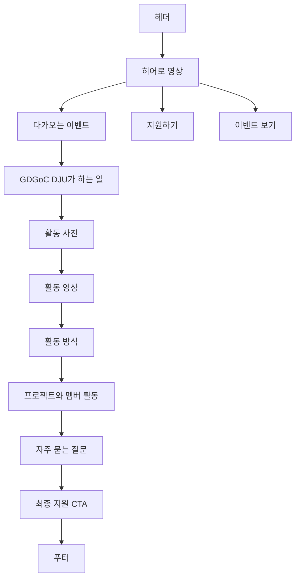

전체 설득 흐름은 다음과 같다.

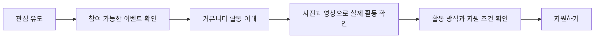

## 4. 섹션 설계

### 4.1 헤더

- DJU 로고
- 이벤트
- 프로젝트
- 활동 기록
- 소개
- 로그인
- 지원하기

`지원하기`는 주 CTA로 강조하고, `로그인`은 기존 멤버용 보조 CTA로 둔다.

### 4.2 히어로

행사·발표·프로젝트 활동을 담은 짧은 영상 또는 대표 사진을 배경으로 사용한다.

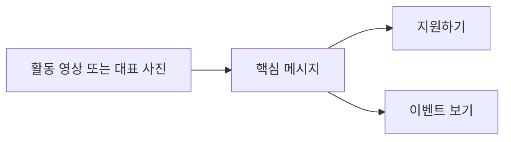

권장 카피:

```text
대진대학교에서
함께 만들고 성장하는 개발자 커뮤니티

배우는 사람에서 만드는 사람으로,
GDGoC DJU에서 다음 활동을 시작해보세요.
```

영상 규칙:

- 음소거 자동재생
- 10~20초 내외의 짧은 루프
- 모바일에서는 대표 이미지로 대체 가능
- 영상이 로드되지 않아도 카피와 CTA는 먼저 노출

### 4.3 다가오는 이벤트

현재 참여 가능한 이벤트를 히어로 다음에 노출한다.

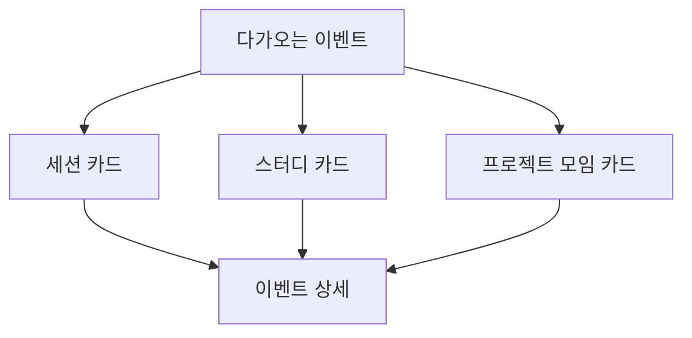

이벤트 카드 필드:

- 이벤트 유형
- 행사명
- 날짜와 시간
- 장소 또는 온라인 여부
- 신청 상태
- 대표 이미지
- 상세 보기 링크

### 4.4 GDGoC DJU가 하는 일

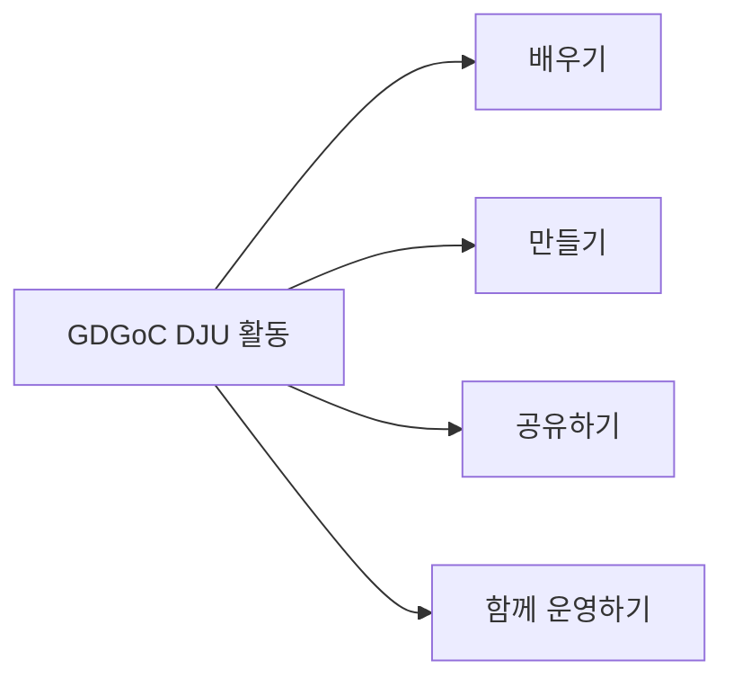

- 배우기: 세션·스터디·기술 학습
- 만들기: 프로젝트·토이 프로젝트
- 공유하기: 발표·회고·질문
- 함께 운영하기: 행사 준비·커뮤니티 운영

각 항목에는 짧은 설명과 실제 활동 사진을 함께 배치한다.

### 4.5 활동 사진

사진은 장식이 아니라 실제 커뮤니티 활동을 증명하는 콘텐츠로 사용한다.

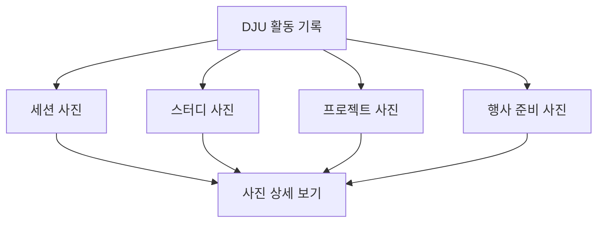

권장 UI:

- 대표 사진 1장과 보조 사진 여러 장으로 구성
- 활동 유형 또는 연도 필터
- 클릭 시 라이트박스
- 사진마다 활동명과 날짜 표시

### 4.6 활동 영상

사진으로 분위기를 전달한 뒤 영상으로 활동 경험을 보여준다.

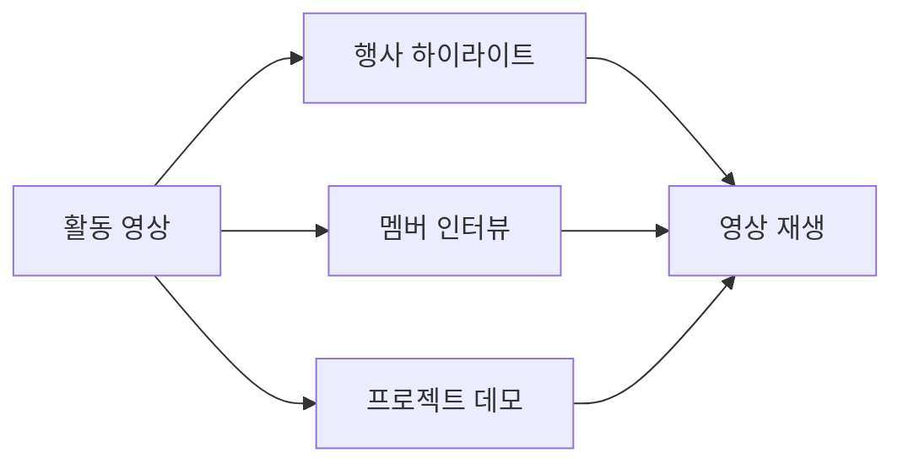

영상 카드 필드:

- 썸네일
- 재생 버튼
- 제목
- 활동 유형
- 영상 길이

초기에는 대표 영상 2~3개만 노출한다. 영상이 충분히 쌓인 뒤 별도 목록 페이지를 추가한다.

### 4.7 활동 방식

GDGoC DJU의 차별점인 비기너·포지션 멤버의 활동 흐름을 설명한다.

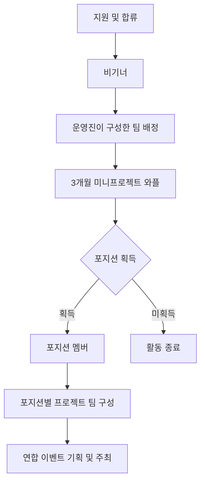

핵심 설명:

- 비기너는 운영진이 정한 팀에서 3개월간 미니프로젝트 `와플`을 진행한다.
- 미니프로젝트는 총 3회차로 진행한다.
- 회차가 끝날 때마다 포지션 리드와 운영진이 포지션 부여 여부를 논의한다.
- 포지션 획득 기준은 하나의 프로젝트를 스스로 개발할 수 있는지 여부다.
- 포지션 멤버는 포지션별 최대 2명으로 프로젝트 팀을 구성할 수 있다.
- GDG 또는 타 대학 GDSC와 연합한 이벤트를 기획·주최할 수 있다.
- 세부 활동은 운영 상황에 따라 변경될 수 있다.

### 4.8 프로젝트와 멤버 활동

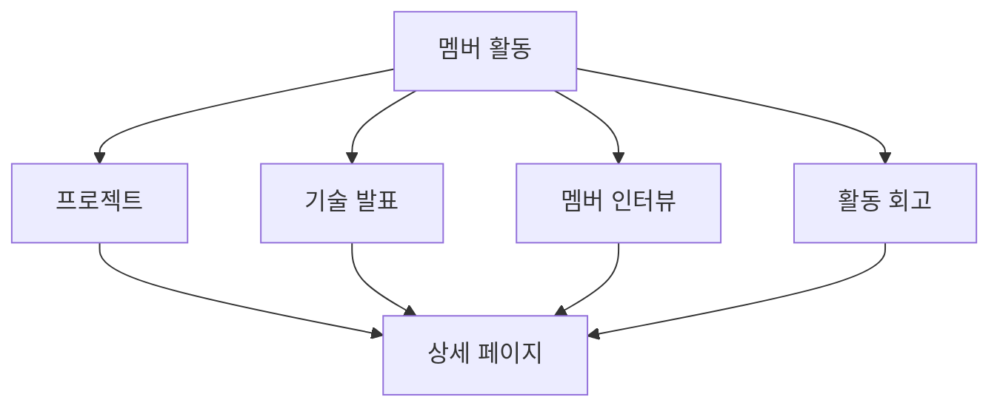

프로젝트 카드에는 다음만 노출한다.

- 프로젝트 제목
- 참여 포지션
- 사용 기술
- 짧은 설명
- 팀 또는 멤버
- 상세 보기

### 4.9 자주 묻는 질문

FAQ는 활동 방식 다음, 최종 지원 CTA 직전에 배치한다. 지원자의 불확실성을 줄이는 전환 보조 섹션이다.

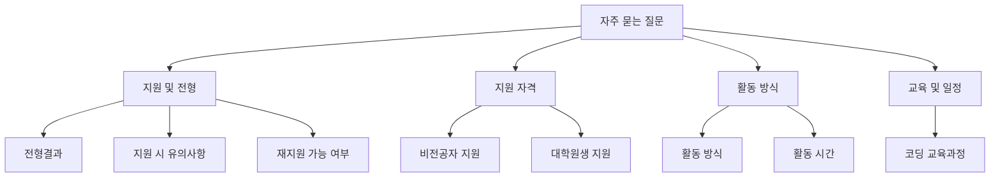

FAQ는 아코디언으로 구현한다.

- 질문을 클릭하면 답변을 펼친다.
- 키보드로 열고 닫을 수 있어야 한다.
- 열린 질문은 시각적으로 구분한다.
- 모바일에서는 카테고리를 가로 스크롤 탭으로 제공한다.
- 문의 이메일은 클릭 가능한 `mailto:` 링크로 제공한다.

#### 지원 및 전형

**전형결과는 언제 알 수 있나요?**

지원기간과 면접기간 종료 후 합격 여부와 관계없이 일주일 안에 지원 시 제공한 연락처로 안내한다.

일주일이 지난 후에도 연락을 받지 못한 경우 `gdgocdju@gmail.com`으로 문의한다.

**지원 시 유의사항이 있나요?**

GDGoC DJU는 모두가 서로의 발전을 위해 노력하는 커뮤니티다. 개인의 코딩 실력뿐 아니라 동료에게 동기를 부여하고 함께 성장할 수 있는 태도도 중요한 평가 요소다.

**불합격한 이력이 있어도 재지원이 가능한가요?**

재지원할 수 있다. 다만 면접 불참, 경고 3회 누적 등으로 탈락한 경우 영구적으로 지원이 제한될 수 있다.

#### 지원 자격

**비전공자도 지원이 가능한가요?**

지원할 수 있다. 재학생과 휴학생이라면 전공과 관계없이 지원할 수 있다.

**대학원생도 지원이 가능한가요?**

지원할 수 없다. Google Developer Groups on Campus 운영 방침에 따라 학부 재학생·휴학생만 지원할 수 있다.

#### 교육 및 커뮤니티 성격

**코딩 교육과정이 있나요?**

GDGoC DJU는 별도의 정규 코딩 교육과정을 운영하지 않는다. 지식 공유와 여러 활동을 통해 멤버 간 시너지를 만드는 것을 목표로 한다.

필요에 따라 Git 사용법, 학습 가이드라인 또는 일부 교육 세션이 진행될 수 있다.

#### 활동 일정

**활동시간이 정해져있나요?**

정기 세미나는 4주마다 금요일 오후 7시에 진행한다. 프로젝트는 팀별로 일정을 조율해 매주 진행하며, 정기 세미나와 프로젝트 외 활동은 자율적으로 진행한다.

학사 일정에 따라 정기 세미나 일정은 변경될 수 있다.

#### 활동 방식

**활동 방식이 궁금해요**

GDGoC DJU는 일반적인 동아리와 달리 멤버의 성장 단계에 따라 활동 방식이 달라진다.

비기너는 운영진이 정한 팀에서 3개월간 미니프로젝트 `와플`을 진행한다. 미니프로젝트는 총 3회차로 진행하며, 각 회차 종료 후 포지션 리드와 운영진이 포지션 부여 여부를 논의한다.

포지션 획득 기준은 하나의 프로젝트를 스스로 개발할 수 있는지 여부다. 상태관리, Git Flow 등의 역량을 함께 고려한다.

포지션을 획득한 멤버는 포지션별 최대 2명으로 프로젝트 팀을 구성할 수 있고, GDG 또는 타 대학 GDSC와 연합한 이벤트를 기획·주최할 수 있다.

세부 활동은 운영 상황에 따라 변경될 수 있다.

### 4.10 최종 지원 CTA

FAQ를 확인한 뒤 바로 지원할 수 있도록 페이지 마지막에 지원 CTA를 배치한다.

```mermaid
flowchart LR
    A[FAQ 확인] --> B{지원 가능 여부 확인}
    B -->|지원 가능| C[GDGoC DJU 지원하기]
    B -->|추가 질문| D[gdgocdju@gmail.com 문의]
```

권장 카피:

```text
궁금한 점이 해결되었나요?

이제 GDGoC DJU에서
함께 만들고 성장해보세요.

[지원하기] [이메일 문의]
```

## 5. 주요 인터랙션

- 헤더 메뉴 이동
- 모바일 메뉴 열기
- 이벤트 카드 이동
- 활동 사진 라이트박스
- 활동 영상 재생
- FAQ 아코디언
- 지원하기 CTA
- 로그인
- 모집 상태 표시

## 6. 컴포넌트 구조

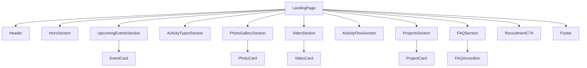

## 7. 반응형 원칙

### 데스크톱

- 히어로는 영상과 카피를 함께 배치한다.
- 활동 사진은 비대칭 갤러리로 구성한다.
- 이벤트와 프로젝트는 3열 카드로 노출한다.
- FAQ 카테고리와 질문 목록을 넓게 배치한다.

### 모바일

- 영상은 대표 이미지로 대체할 수 있다.
- 이벤트·프로젝트 카드는 1열로 쌓는다.
- 사진은 가로 스크롤 갤러리로 단순화한다.
- FAQ 카테고리는 가로 스크롤 탭으로 제공한다.
- 하단에 고정 `지원하기` 버튼을 제공한다.

## 8. 콘텐츠 운영 기준

- 실제 행사·프로젝트 사진과 영상만 사용한다.
- 확인되지 않은 회원 수, 성과 수치, 후기 문구를 만들지 않는다.
- 사진에는 활동명과 날짜를 함께 기록한다.
- 영상이 없을 때는 정적 사진으로 대체한다.
- 모집 상태와 정기 세미나 일정은 운영 데이터에서 가져온다.
- 지원 자격과 활동 방식이 변경되면 FAQ와 CTA를 함께 수정한다.

## 9. 구현 우선순위

1. 헤더·히어로·지원 CTA
2. 다가오는 이벤트
3. 활동 방식과 FAQ
4. 사진 갤러리
5. 활동 영상
6. 프로젝트와 멤버 활동

초기 랜딩페이지에는 복잡한 통계, 별도 영상 목록 페이지, 과도한 애니메이션을 추가하지 않는다. 실제 콘텐츠가 쌓인 뒤 확장한다.

## 10. 디자인 리뷰 기록 (2026-10-15)

커밋 `9a48d66`(히어로 전체 폭 개편, 카드형 활동 섹션, 둘러보기 사용자 화면) 이후 `/`, `/tour/landing`, `/tour/`, `/tour/admin`을 데스크톱(1440)·태블릿(768)·모바일(375)과 라이트·다크 테마에서 확인했다. 랜딩은 사이트 테마와 무관하게 항상 다크 화면이다.

### 고친 것 (`Landing.tsx`, `landing-preview.css`)

- 폰트: `.nb`의 시스템 폰트는 LCP를 위한 의도된 선택이다(`818999c`, docs/research/lighthouse-performance-2026-08-01.md, tests/landing-performance.test.ts). Pretendard로 바꾸지 않는다.
- 둘러보기 안내 배지: 키커와 같은 줄에 붙어 히어로 가운데 정렬이 깨졌다. 블록으로 가운데 두고, 모바일에서 두 줄로 꺾여도 모양이 유지되게 둥근 사각으로 바꿨다.
- 모바일 헤더: 브랜드와 `Google로 로그인하기`가 두 줄로 꺾여 헤더가 약 104px까지 커졌다. 줄바꿈을 막고 간격을 줄여 81px로 맞췄다.
- 활동 카드 리듬: 한 줄로 쌓이면 빈 사진 자리(16:9)가 화면 대부분을 차지했다. 태블릿은 사진 왼쪽·글 오른쪽, 560px 이하는 낮은 5:2 띠로 바꿨다. 데스크톱 3열 4:3은 사진이 들어올 자리라 그대로 뒀다.
- 포커스 링: 전역 `#2d64fa`는 거의 검은 배경에서 대비가 약 3.9:1이다. 랜딩 안에서만 `#8ab4f8`로 밝혔다.
- 다크 고정 화면에 `color-scheme: dark`를 줘 스크롤바·기본 컨트롤이 라이트로 뜨지 않게 했다.
- 리드 문장·후기 인용에 `text-wrap: balance`, 카드 설명에 `text-wrap: pretty`를 줘 한 단어만 남는 줄을 줄였다.
- 둘러보기 모드의 로고 링크를 `/`에서 `/tour/landing`으로 바꿔 둘러보기 안에 머물게 했다.

문구는 바꾸지 않았다.

### 남긴 제안

| 우선순위 | 내용 | 담당 |
| --- | --- | --- |
| 높음 | `/tour/`가 Next 기본 동작으로 `/tour`로 바뀌고, `src/app/tour/route.ts`가 다시 `/tour/landing`으로 보낸다. 그래서 랜딩의 `사용자 화면 미리보기`·`사용자 화면 보기`와 둘러보기 회원 화면의 `홈`이 모두 랜딩으로 되돌아온다. 회원 홈을 `/tour/home` 같은 슬래시 없는 경로로 열거나 `/tour/` 처리 방식을 바꿔야 한다. | 프론트 |
| 높음 | 둘러보기 관리 화면에서 사용자 화면이나 둘러보기 첫 화면으로 가는 링크가 없다. `실제 운영 화면으로 돌아가기`(`/admin`)는 referer 때문에 다시 `/tour/admin`으로 돌아온다. 회원 화면에도 관리 화면으로 가는 길과 "예시 데이터" 배너가 없다. | 프론트 |
| 높음 | 정기세션 일정이 서로 다르다: 카드 `매주 목요일`, 수치 `월 1회`, FAQ(4.9) `4주마다 금요일 오후 7시`. 운영진 확인 후 하나로 맞춘다. | 디자인(콘텐츠, 운영진 확인 필요) |
| 높음 | 비로그인 랜딩의 `150+`·`12`·`5` 수치와 `아쿠아` 후기는 8장 "확인되지 않은 회원 수, 성과 수치, 후기 문구를 만들지 않는다"에 걸린다. 실제 값으로 바꾸거나 섹션을 뺀다. | 디자인(콘텐츠, 운영진 확인 필요) |
| 중간 | 활동 카드 2·3번은 사진 자리가 빈 그라데이션이다. 실제 활동 사진이 생기면 `nb-card-media`에 `next/image`(`fill`, `sizes` 주석 참고)로 넣는다. 임의 placeholder 이미지는 넣지 않는다. | 디자인 |
| 낮음 | 둘러보기 헤더의 `사용자` 링크와 `사용자 화면 보기` 버튼이 같은 곳을 가리킨다. 위 경로 문제를 고칠 때 버튼을 `관리 화면 보기`로 나누는 것을 검토한다. | 프론트 |
